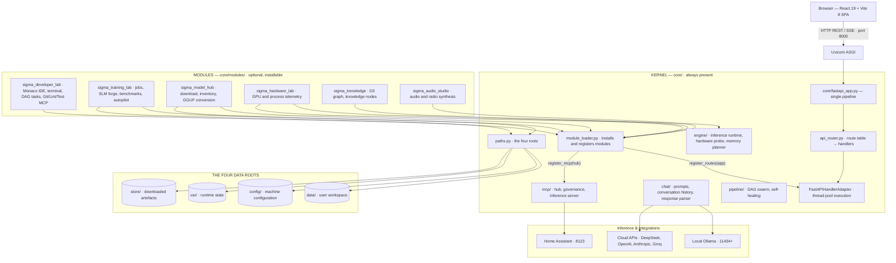
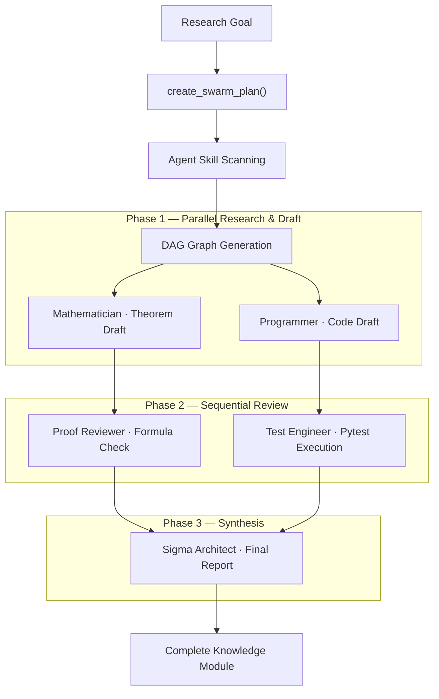
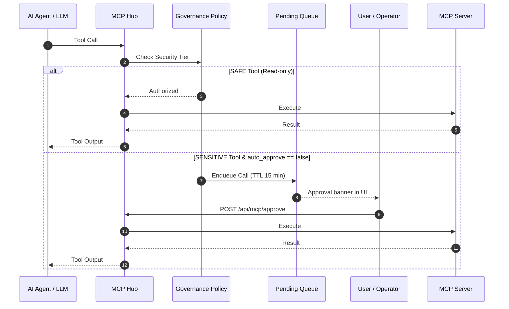
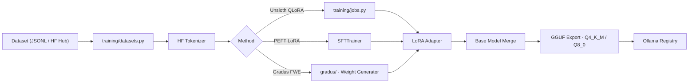

# 🧬 Σ-SIGMA Studio — Technical Architecture & System Specification (Architettura Tecnica)

**Version**: 8.3 — Micro-Kernel Architecture & Modular Developer Studio (Architettura Micro-Kernel)  
**Status**: Real executable system. Every metric in this document was measured on live code, not inferred from reading.  
**Test Suite**: 603 Kernel tests (100% green, verified on Pytest).  
**Stack**: Python 3.10+ (FastAPI / Uvicorn), React 19, Vite 8, PyTorch, Unsloth, HuggingFace, KaTeX, D3.js  
**Verified Platforms**: Windows 11 (x86_64, NVIDIA CUDA) and Raspberry Pi 5 (aarch64, CPU only)  

---

## 1. 🌐 Architectural Principles

1. **Executable code is the sole authority.** Documentation tracks the code, never vice versa. Where this document states a number, that number was measured.
2. **The kernel never names a module.** The kernel exposes *services* — where files live, hardware telemetry, streaming primitives, model loading. A module declares its own dependencies. If functionality belongs only to a specific domain (training, evaluation, audio, advanced IDE development), it belongs in an installable module.
3. **Paths are requested, never rebuilt.** All roots resolve through `core/paths.py`. No file walks up `__file__` on its own and no file opens a relative path from the working directory (§ 4.2).
4. **Sandbox on whitelisted paths.** Agent execution, file operations, and test scripts are strictly confined to whitelists (`core/security/sandbox.py`) and isolated timeouts (`core/security/sandbox_manager.py`).
5. **Governed interoperability via MCP.** External tools, peripherals, and services communicate exclusively via MCP servers, with human approval gates for sensitive calls.
6. **Hardware-adaptive execution.** The engine measures VRAM, system RAM, and compute load to configure precision, batching, and KV-cache offloading. The same codebase runs on a dual-GPU workstation and on an 8 GB Raspberry Pi 5.
7. **Every scan gets a strict budget.** No filesystem traversal or file-reading operation is allowed to be unbounded: per-file cap, total cap, deadline, and partial results instead of infinite hangs.

---

## 2. 🏛️ Overall Architecture



**The golden dependency rule**: arrows pointing toward the kernel are permitted; arrows from the kernel pointing to a module are forbidden.

---

## 3. 💻 Frontend (`sigma_studio/`)

### 3.1 Stack
- **React 19** (`react`, `react-dom` v19.2.4) on **Vite 8**
- **KaTeX** for inline/block mathematical formulas, **Mermaid** for diagrams, **D3 v7** for relational graphs, **Prism** for code syntax highlighting, **Three.js** for 3D rendering.

### 3.2 Dynamic Module Discovery
`src/modules/registry.js` uses Vite's `import.meta.glob` to bundle only modules that are **physically present** in `src/modules/`. An uninstalled module is excluded from the bundle and `getLazyModule()` returns `null`, activating the `ModuleNotInstalled` fallback screen.

### 3.3 State Management
`AppContext` centralizes state across domain hooks: `useModules`, `useTasks`, `useTabs`, `useFileOps`, `useModuleOps`. Chat operations reside in `src/components/Chat/core/` (`useChatCore`, `useChatStreaming`, `useMcpAutoApprove`, `useResearchPipeline`).

---

## 4. ⚙️ Backend Architecture

### 4.1 A Single Request Pipeline

`sigma_server.py` **prepares the environment and launches uvicorn**. Nothing else.

Request routing flow:
```
uvicorn → app → _dispatch_route(path, method)
                  ├─ SSE?  Dedicated thread + asyncio queue → StreamingResponse
                  └─ JSON? _api_executor (32 threads) → JSONResponse
```

**Two dedicated thread pools, sized for workload rather than CPU core count:**
Handlers are synchronous: the default executor would allocate `min(32, cpu+4)` threads — eight threads on an 8 GB Pi 5, where two slow I/O calls could starve all other endpoints. Hence `_API_WORKERS = 32` and `_STREAM_WORKERS = 16`: these worker threads wait on I/O and engine locks, avoiding CPU starvation.

### 4.2 `core/paths.py` — Centralized Path Authority

The project root is calculated once and anchored to the codebase location. `SIGMA_HOME` allows relocating the installation tree entirely.

### 4.3 The Four Data Roots

| Root | Holds | If deleted | Back up |
|:---|:---|:---|:---:|
| `data/` | Topics, notes, generated media — user work | **Data loss** | Yes |
| `config/` | Machine configuration, provider keys, installed modules — **contains credentials** | Resets to defaults | Yes |
| `var/` | Developer Studio tasks, session cache, search indices | Clean restart | No |
| `store/` | Downloaded model weights (122 GB), shards, engine tools | Re-downloads | No |

---

## 5. 🧩 Module System

### 5.1 Lifecycle
`core/module_loader.py` installs modules from `SigmaStudio-Moduli` (git sparse-checkout, with ZIP archive fallback) or from adjacent local clones:
```
modules/<id>/backend/   →  core/modules/<id>/
modules/<id>/frontend/  →  sigma_studio/src/modules/<id>/
```
It then installs required packages from `requirements.txt`, rebuilds frontend modules, and invokes `register_routes(app)` and `register_mcp(hub)`.

### 5.2 Module Manifest (`manifest.json`)
```json
{
  "id": "sigma_training_lab",
  "version": "v1.0.0",
  "backend":  { "handlers_module": "...", "routes_prefix": "/api/training" },
  "frontend": { "entrypoint": "frontend/index.jsx" },
  "requirements": "requirements.txt",
  "kernel_modules_required": []
}
```

---

## 6. 🤖 Swarm & Agent Orchestration

### 6.1 Agent Catalog
The twenty stock agents reside in `core/agents/catalog/`: a `catalog.json` file with role metadata and one Modelfile per agent, editable as plain text.

### 6.2 Dynamic DAG Planning (`core/pipeline/dynamic_swarm.py`)


---

## 7. 🔌 MCP & Governance



---

## 8. 🔬 Training Lab (`sigma_training_lab`)



Training datasets live in `store/training/` and `store/training_lab/` to survive module uninstallation.

---

## 9. 🔒 Security & Sandbox Whitelisting

- **Filesystem Sandbox Whitelist** (`core/sandbox.py`): Direct access is restricted to `data/`, `manifesti/`, `scratch/`, `sigma_studio/`, `core/`.
- **AST Parsing**: Agent-generated Python code undergoes `ast.parse()` validation prior to execution.
- **Process Confinement**: `shlex.split`, no `shell=True`, enforced timeout limits.
- **Budgeted Search** (`core/harness/fs_manager.py`): Heavy directory pruning, 2 MB max per file, null byte detection, 20-second timeout to prevent memory spikes.
