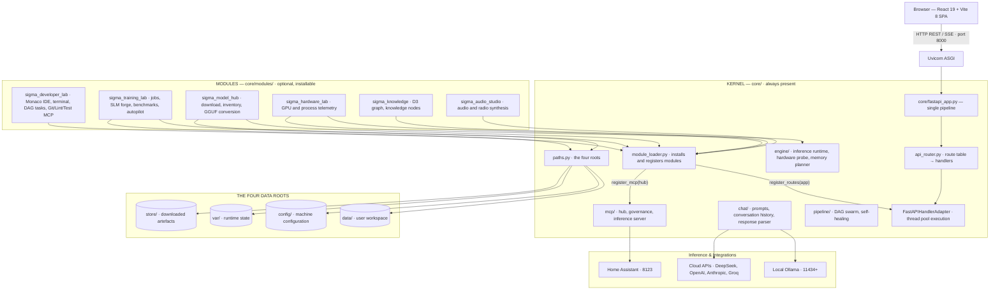
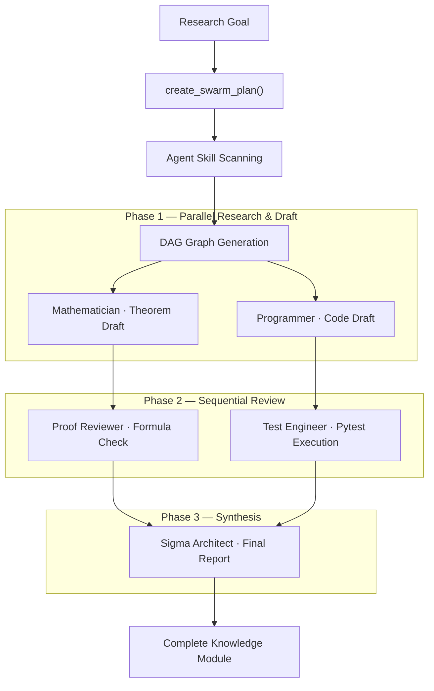
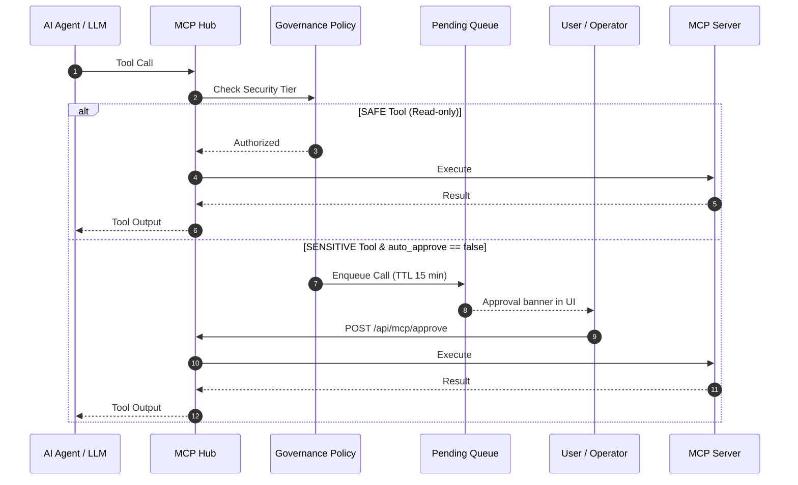
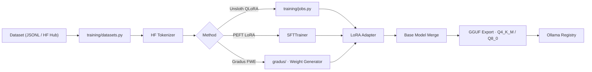

# 🧬 Σ-SIGMA Studio — Technical Architecture & System Specification (Architettura Tecnica)

**Version**: 8.4 — Confini del kernel, servizi opzionali e Home per campi di lavoro

**Status**: Specifica del codice; i controlli statici descrivono la struttura e non misurano le prestazioni.

**Test Suite**: I risultati dipendono da piattaforma e moduli presenti; usare i lotti eseguibili descritti in fondo.
**Stack**: Python 3.10+ (FastAPI / Uvicorn), React 19, Vite 8, PyTorch, Unsloth, HuggingFace, KaTeX, D3.js  
**Piattaforme obiettivo**: Windows 11 e Raspberry Pi 5 (aarch64, CPU, 8 GB). La verifica su Docker Linux CPU non certifica i driver Windows, CUDA o le prestazioni sul Pi.

---

## 1. 🌐 Architectural Principles

1. **Il codice eseguibile è l'autorità.** Distinguere test, euristiche statiche e misure sul dispositivo reale; non dedurre throughput o correttezza dal numero di file presenti.
2. **The kernel never names a module.** The kernel exposes *services* — where files live, hardware telemetry, streaming primitives, model loading. A module declares its own dependencies. If functionality belongs only to a specific domain (training, evaluation, audio, advanced IDE development), it belongs in an installable module.
3. **Paths are requested, never rebuilt.** All roots resolve through `core/paths.py`. No file walks up `__file__` on its own and no file opens a relative path from the working directory (§ 4.2).
4. **Sandbox on whitelisted paths.** Agent execution, file operations, and test scripts are strictly confined to whitelists (`core/security/sandbox.py`) and isolated timeouts (`core/security/sandbox_manager.py`).
5. **Governed interoperability via MCP.** External tools, peripherals, and services communicate exclusively via MCP servers, with human approval gates for sensitive calls.
6. **Hardware-adaptive execution.** The engine measures VRAM, system RAM, and compute load to configure precision, batching, and KV-cache offloading. The same codebase runs on a dual-GPU workstation and on an 8 GB Raspberry Pi 5.
7. **Every scan gets a strict budget.** No filesystem traversal or file-reading operation is allowed to be unbounded: per-file cap, total cap, deadline, and partial results instead of infinite hangs.

---

## 2. 🏛️ Overall Architecture



**The golden dependency rule**: arrows pointing toward the kernel are permitted; arrows from the kernel pointing to a module are forbidden.

---

## 3. 💻 Frontend (`sigma_studio/`)

### 3.1 Stack
- **React 19** (`react`, `react-dom` v19.2.4) on **Vite 8**
- **KaTeX** for inline/block mathematical formulas, **Mermaid** for diagrams, **D3 v7** for relational graphs, **Prism** for code syntax highlighting, **Three.js** for 3D rendering.

### 3.2 Dynamic Module Discovery
`src/modules/registry.js` uses Vite's `import.meta.glob` to bundle only modules that are **physically present** in `src/modules/`. An uninstalled module is excluded from the bundle and `getLazyModule()` returns `null`, activating the `ModuleNotInstalled` fallback screen.

### 3.3 Home per campi di lavoro

`utils/workDomains.js` raggruppa i ruoli attivi per campo e sceglie un rappresentante, mantenendo l'identificativo del ruolo reale. La chat conserva la selezione individuale degli specialisti. `workDomain` nei metadati prevale sulle euristiche di compatibilità.

`GET /api/modules/local` descrive il catalogo locale senza richieste al repository remoto. La Home mostra strumenti con `available: true` e collega `tabType` e `workspaceTabs` dichiarati dal modulo. L'apertura di una conversazione ripulisce richieste pendenti precedenti, evitando invii involontari.

Chat, configurazione, workspace e scena 3D sono caricati con `React.lazy`; la plancia 2D evita il caricamento della scena 3D sulle macchine meno adatte. Gli hook React sono chiamati in ordine stabile, verificato da un controllo dedicato.

### 3.4 State Management
`AppContext` centralizes state across domain hooks: `useModules`, `useTasks`, `useTabs`, `useFileOps`, `useModuleOps`. Chat operations reside in `src/components/Chat/core/` (`useChatCore`, `useChatStreaming`, `useMcpAutoApprove`, `useResearchPipeline`).

---

## 4. ⚙️ Backend Architecture

### 4.1 A Single Request Pipeline

`sigma_server.py` **prepares the environment and launches uvicorn**. Nothing else.

Request routing flow:
```
uvicorn → app → _dispatch_route(path, method)
                  ├─ SSE?  Dedicated thread + asyncio queue → StreamingResponse
                  └─ JSON? _api_executor (32 threads) → JSONResponse
```

**Two dedicated thread pools, sized for workload rather than CPU core count:**
Handlers are synchronous: the default executor would allocate `min(32, cpu+4)` threads — eight threads on an 8 GB Pi 5, where two slow I/O calls could starve all other endpoints. Hence `_API_WORKERS = 32` and `_STREAM_WORKERS = 16`: these worker threads wait on I/O and engine locks, avoiding CPU starvation.

### 4.2 `core/paths.py` — Centralized Path Authority

The project root is calculated once and anchored to the codebase location. `SIGMA_HOME` allows relocating the installation tree entirely.

### 4.3 The Four Data Roots

| Root | Holds | If deleted | Back up |
|:---|:---|:---|:---:|
| `data/` | Topics, notes, generated media — user work | **Data loss** | Yes |
| `config/` | Machine configuration, provider keys, installed modules — **contains credentials** | Resets to defaults | Yes |
| `var/` | Sessioni, task Developer Studio, indici e cache | Le cache sono ricreabili; sessioni e task possono contenere lavoro utile | Selettivo |
| `store/` | Pesi scaricati, strumenti, dataset e risultati di training | I download possono essere recuperati; dataset e artefatti personali possono andare persi | Selettivo |

La policy di backup deve includere anche `works/`, ruoli personalizzati e artefatti di training quando presenti. Proteggere le copie di `config/` come credenziali. Non eliminare intere radici assumendo che contengano soltanto cache.

---

## 5. 🧩 Module System

### 5.1 Lifecycle
`core/module_loader.py` installs modules from `SigmaStudio-Moduli` (git sparse-checkout, with ZIP archive fallback) or from adjacent local clones:
```
modules/<id>/backend/   →  core/modules/<id>/
modules/<id>/frontend/  →  sigma_studio/src/modules/<id>/
```
Il loader installa i requisiti, ricostruisce il frontend e invoca i contratti di registrazione. Errori di pip, build o registrazione interrompono l'installazione: codice, dist, stato e registri posseduti vengono ripristinati. La modifica dell'ambiente pip e gli effetti arbitrari eseguiti all'importazione dal modulo non sono transazionali: per questi serve un ambiente separato.

`core/service_registry.py` espone capacità senza dipendere dai laboratori. `register_services(registry)` prepara i servizi anche prima di HTTP; `register_routes(app)`, `register_mcp(hub)` e la registrazione dei tool appartengono al modulo. Il kernel usa nomi di capacità come `models.inventory` o `artifacts.downloads`, senza importare implementazioni opzionali. Senza un provider di inventario viene usata una scansione minima con budget.

Gli identificativi e i percorsi sono validati; gli archivi ZIP hanno limiti di download, espansione e numero di elementi e non possono uscire dalla directory di estrazione. Le registrazioni vengono rimosse per proprietà, evitando di cancellare server di altri moduli con nomi simili. `enabled_by_default` nel manifest consente il bootstrap senza elenchi di moduli nel kernel.

### 5.2 Module Manifest (`manifest.json`)
```json
{
  "id": "sigma_training_lab",
  "version": "v1.0.0",
  "backend":  { "handlers_module": "...", "routes_prefix": "/api/training" },
  "frontend": { "entrypoint": "frontend/index.jsx" },
  "requirements": "requirements.txt",
  "kernel_modules_required": []
}
```

---

### 5.3 Contratto del laboratorio KiCad

Il laboratorio distribuisce un solo catalogo di schemi ed esecutori per harness e MCP. Le route manuali dell'editor delegano agli stessi tool. Le richieste dichiarano il progetto e lo eseguono in un contesto isolato su un thread, evitando lo scambio della scheda attiva tra richieste concorrenti.

`advanced_tools.py` espone costruttori, zone, classi di net, regole e sincronizzazione delle connessioni; `board_operations.py` applica le modifiche tramite pcbnew nell'interprete di KiCad. Una zona aggiunta dichiara esplicitamente che resta da riempire. La sincronizzazione XML aggiorna i pad esistenti e rifiuta riferimenti mancanti; non crea componenti o schematici. Le modifiche al PCB hanno backup e annullamento/ripetizione; le regole e le classi di net restituiscono copie di sicurezza dei rispettivi file.

DRC/ERC richiedono un report nuovo e valido: assenza del report, errore del comando o connessioni mancanti non diventano un risultato pulito. La creazione di un progetto rifiuta la sovrascrittura di file esistenti. Le integrazioni di produzione usano la [CLI ufficiale di KiCad](https://docs.kicad.org/9.0/en/cli/cli.html); la verifica locale su Linux con KiCad 9 non sostituisce quella su Windows o Raspberry Pi.

## 6. 🤖 Swarm & Agent Orchestration

### 6.1 Agent Catalog
The twenty stock agents reside in `core/agents/catalog/`: a `catalog.json` file with role metadata and one Modelfile per agent, editable as plain text.

### 6.2 Dynamic DAG Planning (`core/pipeline/dynamic_swarm.py`)


---

### 6.3 Isolamento delle sessioni di sviluppo

L'harness crea una worktree Git per isolare le modifiche di ogni sessione dal progetto di partenza. La consegna verifica il diff e fonde il lavoro con le modifiche intervenute nel frattempo; un conflitto mantiene il lavoro recuperabile e richiede risoluzione. La sandbox Docker è un confine aggiuntivo quando configurata per il progetto, e non è implicita per qualunque terminale.

## 7. 🔌 MCP & Governance



---

## 8. 🔬 Training Lab (`sigma_training_lab`)



Training datasets live in `store/training/` and `store/training_lab/` to survive module uninstallation.

---

## 9. 🔒 Security & Sandbox Whitelisting

- **HTTP** (`core/security/http_access.py`): accesso locale con validazione di Host e Origin; per accesso remoto usare `SIGMA_API_TOKEN` come Bearer o il login browser con cookie firmato, HttpOnly, SameSite Strict e scadenza. Host e origini aggiuntive si dichiarano con `SIGMA_ALLOWED_HOSTS` e `SIGMA_ALLOWED_ORIGINS`. Usare HTTPS per trasportare credenziali su una rete non fidata.
- **TLS**: gli errori di certificato si propagano al chiamante; nessun fallback implicito verso connessioni non verificate.
- **Richieste e streaming**: body limitato a 64 MiB per default (`SIGMA_MAX_REQUEST_BYTES`), anche senza Content-Length. Gli stream del dispatcher legacy, i protocolli di inferenza nativi e il fanout condividono un budget di 16 produttori con code di 256 messaggi e backpressure. La disconnessione interrompe la consegna e chiude il generatore; un calcolo già bloccato termina al successivo punto di cooperazione e mantiene occupato il proprio posto fino alla chiusura. Il limite non comprende eventuali stream autonomi dei moduli.
- **Filesystem**: percorsi statici e argomenti devono rimanere nelle rispettive radici. I percorsi dell'harness sono relativi al progetto autorizzato; un percorso Docker deve corrispondere al contenitore della sessione.
- **Ricerca** (`core/harness/fs_manager.py`): esclusione di directory di runtime, limite per file, rilevazione binari e deadline. L'audit del supervisore ha un budget di 10.000 file / 3 secondi e dichiara risultati parziali.
- **MCP**: `tools/call` passa dal medesimo controllo di autorizzazione anche quando viene specificato un server; un'approvazione è associata a server e argomenti originali. I tool senza livello dichiarato sono sensibili.
- **Persistenza**: `JsonStore` usa lock condiviso nel processo, file temporaneo univoco, fsync e sostituzione atomica. Non costituisce un lock distribuito tra processi.
- **Lavori durevoli** (`core/job_store.py`, `core/job_worker.py`): SQLite conserva parametri, esito e identificativo della richiesta. Il claim è transazionale; per default sono ammessi 100 lavori pendenti e un esecutore attivo per registro. Una lease scaduta produce lo stato `interrupted`, senza ripetere automaticamente operazioni che potrebbero avere già modificato file. L'editor conserva il registro `.editor_jobs.sqlite3` nella radice delle produzioni: appartiene al backup dei progetti, insieme ai checkpoint. La ripresa esplicita è abilitata solo per operazioni dichiarate riprendibili.
- **Prenotazioni** (`core/resource_pool.py`): l'acquisizione di un insieme di risorse è atomica nel processo. Editor e produzione video la usano prima di avviare il lavoro, oltre alle lease fisiche delle GPU. Non è un limite imposto dal sistema operativo alla RAM/VRAM e non coordina applicazioni esterne o processi che non partecipano al protocollo.
- **Diagnostica** (`core/request_context.py`): le risposte HTTP espongono `X-Request-ID`; un UUID valido del chiamante viene conservato. Lo stesso identificativo attraversa i thread del dispatcher, i log e il registro dei job. Non vengono aggiunti ai log body o credenziali delle richieste.
- **Contratto dei pacchetti**: `min_kernel_version`, `kernel_api` e `required_kernel_features` vengono verificati prima di copiare o importare il modulo. I pacchetti storici senza questi campi mantengono il percorso di compatibilità; quelli nuovi possono dichiarare requisiti espliciti. La versione backend è centralizzata in `core/version.py`, quella frontend deriva da `sigma_studio/package.json`.
- **Campi di lavoro**: il catalogo dei ruoli dichiara `workDomain`; Home, registro degli agenti e selettore della chat ricevono gli stessi metadati. Un ruolo privato può dichiarare `# WorkDomain:`. Il campo guida la navigazione; le autorizzazioni degli strumenti restano affidate a ToolPolicy e alla governance MCP.

## 10. Verifica e limiti delle misure

Eseguire i test in un ambiente isolato quando Sigma Studio sta lavorando. Non avviare pytest nell'ambiente con il server di sviluppo attivo sulla porta 8000.

```bash
python -m tests.run_lotti base harness chat mcp
python -m tests.run_lotti motore
python -m tests.run_lotti moduli
npm --prefix sigma_studio run lint:undef
cd sigma_studio
npx --no-install eslint -c eslint.config.hooks.js --no-inline-config src/
node --test tests/*.test.mjs
npm run build
```

Il runner seleziona i file dei lotti prima della raccolta: il test del kernel non importa laboratori pesanti estranei. I contratti architetturali verificano l'assenza di import inversi e definizioni duplicate, e importano il kernel in un processo che blocca i moduli opzionali.

La CI include Python 3.10–3.12 e un job ARM64; la configurazione della matrice non equivale a una misura su Raspberry Pi. Il frontend ha controlli per riferimenti indefiniti e ordine degli hook; il lint completo include ancora debito storico e resta un controllo distinto.

La CLI espone codici di uscita distinti: `0` per obiettivo raggiunto, `2` per lavoro non concluso, `1` per errore e `130` per interruzione. Con `--json`, stdout contiene gli eventi JSON e stderr riceve la diagnostica, comprese le stampe dei provider. Il runtime viene importato dopo aver separato i due canali.

Il backend Rust può delegare il calcolo a un server di inferenza: selezionare Rust non prova che l'inferenza avvenga nel codice SIMD proprietario. I test nativi richiedono il sorgente opzionale e Cargo; in loro assenza vengono segnalati come saltati. Un audit strutturale o un tempo IPC costante non sono una misura di throughput. La persistenza dei soli token del prefisso non persiste i tensori KV e non azzera il prefill al riavvio.
